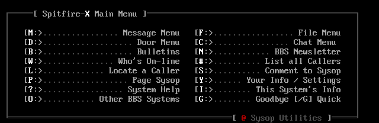

# Spitfire-X BBS

Spitfire-X is a bulletin board system for Windows and Linux, inspired by Mike Woltz's original SPITFIRE.

## Public beta coming soon

We're preparing the first public beta. This repository will be the home for the source code, Windows and Linux downloads, and release notes.

SFX brings together messages, file areas, DOS and native Doors, FTN networking and QWK offline mail. Windows uses a desktop Control Panel and SFXConfig; Linux uses browser-based Sysop controls.

Source code and downloads are not available here yet.

## A look at SFX

Maintained by [xbit ops](https://github.com/xbit44).
