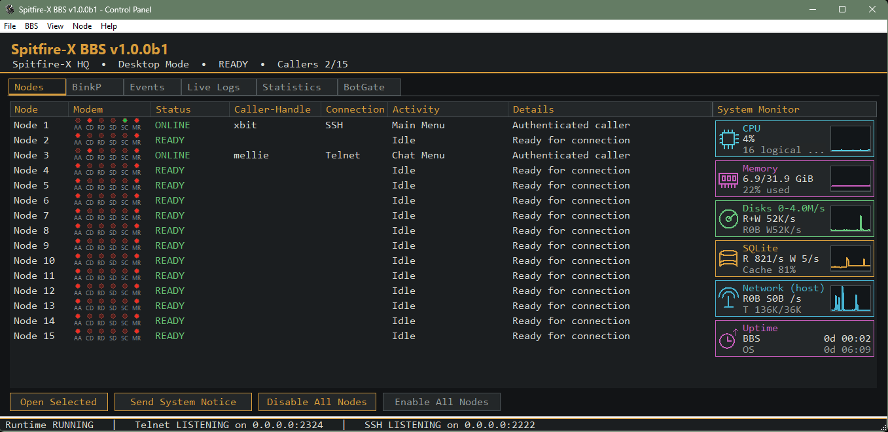

# Spitfire-X BBS

Spitfire-X is a bulletin board system for Windows and Linux, inspired by Mike Woltz’s original SPITFIRE BBS. It supports Telnet and SSH, messages, file transfers, FTN networking, QWK offline mail, and DOS and native Doors.

## Download the public beta

Get the Windows x86 ZIP or Linux x86-64 TAR and its SHA-256 checksum from the [v1.0.0b5 release](../../releases/tag/v1.0.0b5). Follow the README in your download to install or upgrade. Windows uses a desktop Control Panel and SFXConfig. Linux uses browser-based Sysop controls.

Use the matching Full Source archive from the release to build the packages. See the [build guide](distribution/BUILDING.txt), [third-party notices](distribution/ThirdParty/) and [MIT license](LICENSE).

Maintained by [xbit ops](https://github.com/xbit44).
